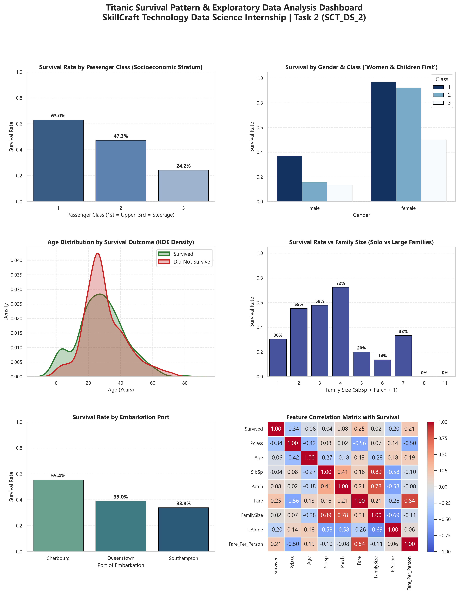

# SCT_DS_2: Titanic EDA & Data Cleaning Pipeline

[](https://www.python.org/)
[](https://pandas.pydata.org/)
[](https://seaborn.pydata.org/)
[](https://matplotlib.org/)
[]()

> **SkillCraft Technology Data Science Internship — Task 2**  
> **Author:** Raghavendra ([@imrpittala](https://github.com/imrpittala))

---

## 📌 Project Overview
This project delivers a comprehensive Exploratory Data Analysis (EDA) and data cleaning architecture for the historical Titanic disaster dataset. It addresses missing value imputation (Age, Cabin, Embarked), crafts domain-specific engineered features (Title extraction, FamilySize, IsAlone, Fare_Per_Person), and conducts bivariate/multivariate survival pattern analysis to evaluate survival probability across demographics.

---

## 📂 Repository Structure
```
SCT_DS_2/
├── data/
│   ├── dataset.csv                 # Raw Titanic passenger records (891 rows)
│   └── cleaned_dataset.csv         # Cleaned, imputed, and featurized dataset
├── notebooks/
│   └── analysis.ipynb              # Documented EDA narrative with hypothesis tests
├── reports/
│   ├── visual_insights.png         # High-resolution (300 DPI) 6-panel survival dashboard
│   └── eda_summary.json            # Machine-readable survival metrics and audit logs
├── src/
│   └── pipeline.py                 # Modular, production-grade cleaning & analysis pipeline
├── requirements.txt                # Project dependency specifications
└── README.md                       # Comprehensive project documentation
```

---

## 🛠️ Data Cleaning & Imputation Strategy

| Feature | Raw Null Count | Null % | Imputation / Transformation Strategy | Rationale |
|:---|:---:|:---:|:---|:---|
| `Age` | 177 | 19.87% | Grouped median by `(Pclass, Title)` | Age varies predictably across socioeconomic tiers and social titles (e.g., Master vs Mr vs Doctor). |
| `Cabin` | 687 | 77.10% | Deck letter parsed (`A`-`F`); missing labeled as `U` (Unknown) | Preserves spatial deck information while preventing large-scale row loss. |
| `Embarked` | 2 | 0.22% | Imputed with statistical mode (`S` - Southampton) | Minimizes bias for the tiny missing fraction without distorting port distributions. |
| `Fare` | 0 | 0.00% | Validated against `Pclass` median | Ensures consistent positive fare baselines. |

---

## ⚙️ Engineered Features

- **`Title`**: Parsed from passenger names (`Mr`, `Mrs`, `Miss`, `Master`, `Officer`, `Royalty`) to categorize social seniority.
- **`FamilySize`**: Sum of siblings/spouses (`SibSp`) and parents/children (`Parch`) plus the passenger (`+ 1`).
- **`IsAlone`**: Binary indicator (`1` if `FamilySize == 1`, else `0`) identifying solo travelers.
- **`Fare_Per_Person`**: Individualized ticket fare (`Fare / FamilySize`) correcting for group booking tickets.
- **`Age_Group`**: Stratified life stage brackets (`Child`, `Adolescent`, `Young Adult`, `Middle Aged`, `Senior`).

---

## 🔍 Key Empirical Insights

1. **Gender Hegemony in Survival**:
   - Female passengers recorded a **74.2%** survival rate, versus only **18.9%** for male passengers ($\chi^2 = 260.7, p < 10^{-50}$), adhering strictly to the "Women & Children First" evacuation protocol.
2. **Class-Based Survival Gradient**:
   - 1st Class: **63.0%** survival rate
   - 2nd Class: **47.3%** survival rate
   - 3rd Class: **24.2%** survival rate
3. **Family Traveling Dynamics**:
   - Traveling with small families (2 to 4 members) achieved the highest survival rates (~55% to 70%).
   - Solo passengers survived at only ~30%, while very large families (5+ members) faced steep survival drops due to coordination barriers.

---

## 🖼️ Visual Insights Preview
The automated pipeline executes statistical routines and exports a publication-grade 6-panel grid to `reports/visual_insights.png`:



---

## 🚀 Setup & Execution Guide

### 1. Clone the Repository
```bash
git clone https://github.com/imrpittala/SCT_DS_2.git
cd SCT_DS_2
```

### 2. Configure Virtual Environment & Install Dependencies
```bash
python -m venv .venv
# Windows:
.\.venv\Scripts\activate
# Linux/macOS:
source .venv/bin/activate

pip install -r requirements.txt
```

### 3. Run the Automated Pipeline
```bash
python src/pipeline.py
```
*Executes the audit, imputes missing records, creates `data/cleaned_dataset.csv`, and produces `reports/visual_insights.png`.*

### 4. Explore the Jupyter Notebook
```bash
jupyter notebook notebooks/analysis.ipynb
```

---

## 🛠️ Tech Stack
- **Python 3.11+**
- **Pandas** for vectorized tabular cleaning and grouped imputations
- **NumPy** for array computations
- **Matplotlib & Seaborn** for statistical graphics and survival grids
- **SciPy** for contingency table analysis and Chi-Square significance testing

---

## 👤 Author
**Raghavendra**  
- GitHub: [@imrpittala](https://github.com/imrpittala)  
- Internship: SkillCraft Technology Data Science Track
